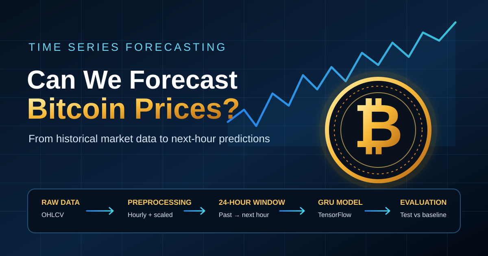

# Can We Forecast Bitcoin Prices with Deep Learning?

*My journey from raw market data to next-hour predictions using TensorFlow and GRU networks.*

> **Publication note:** Both market-only and news-enhanced experiments have been run and the measured metrics are included below. Insert the generated plots from the local `results` folders before publishing. In this run, adding news sentiment did not improve the test metrics.

Bitcoin prices can move quickly. News, regulation, interest rates, liquidity, and investor behaviour can all influence the market. That makes Bitcoin an interesting challenge for machine learning — and a good reminder that a model's prediction is never a promise.

In this project, I built a time-series forecasting pipeline to explore a focused question: can the previous 24 hours of Bitcoin market data help estimate the next hour's closing price?

The project uses Python, pandas, NumPy, TensorFlow, and a recurrent neural network called a GRU. This article explains the process in plain language so that another learner can reproduce the experiment.

## 1. What is time-series forecasting?

A time series is a sequence of observations collected over time. Hourly Bitcoin closing prices are one example. Electricity demand, daily sales, and weather measurements are others.

Time-series forecasting uses earlier observations to estimate a future value. The order of the data matters: when predicting a future price, we must not let information from that future period leak into training.

My model uses 24 consecutive hourly observations as input, predicts the next-hour log return, and converts that estimate into a closing-price forecast.

For example:

```text
Input:  Hour 1, Hour 2, ... Hour 24
Target: Hour 25 closing price

Input:  Hour 2, Hour 3, ... Hour 25
Target: Hour 26 closing price
```

This moving input window is called a sliding window.

## 2. Preprocessing: making raw data useful

The market dataset contains minute-level Bitcoin observations. I aggregate them into hourly rows because the task is to estimate an hourly close.

For each hour, the script calculates the first open, highest high, lowest low, last close, and total BTC and currency volumes. If the source file contains only BTC volume, currency volume is estimated from BTC volume multiplied by the close; this is an approximation, not an exchange-reported USD volume.

Real datasets also contain missing intervals. The preprocessing code fills missing closing prices forward, fills missing open/high/low values with the closing price, and sets missing volume values to zero. These choices keep the series usable, although filled values should always be treated cautiously.

Next, I standardize the features:

```text
standardized value = (value - training mean) / training standard deviation
```

The mean and standard deviation are calculated from the training period only. This is important: using statistics from the future validation or test periods would leak information into the model.

I split the observations chronologically:

- First 70% — training
- Next 15% — validation, used to monitor training and select the best model
- Final 15% — held-out test set, used for final evaluation

This is a more realistic test than randomly mixing past and future observations.

## 3. Building the TensorFlow dataset

TensorFlow's `timeseries_dataset_from_array` creates the 24-hour input windows and pairs them with their next-hour targets.

```python
dataset = tf.keras.utils.timeseries_dataset_from_array(
    data=window_data,
    targets=labels,
    sequence_length=24,
    sequence_stride=1,
    sampling_rate=1,
    shuffle=shuffle,
    batch_size=64,
)
```

Here, `sequence_length=24` means that each example contains 24 hourly observations. `sequence_stride=1` moves the window forward by one hour. `batch_size=64` lets the model process up to 64 examples at a time.

I also use prefetching to prepare upcoming batches while the model works on the current batch.

The training windows can be shuffled, but the validation and test windows remain chronological. The model never trains on the held-out test targets.

## 4. Why a GRU model?

A recurrent neural network is designed to process sequences. A GRU — or Gated Recurrent Unit — uses gates to help retain or update information as it moves through the sequence.

The model architecture is:

1. GRU layer with 64 units, returning its full sequence
2. GRU layer with 32 units
3. Dense layer with 16 neurons and ReLU activation
4. Dense output layer with one predicted value: the next-hour log return

I use the Adam optimizer and mean squared error (MSE) as the loss function. I also track mean absolute error (MAE). Early stopping monitors validation loss, and model checkpointing saves the best model.

## 5. Results: does the model beat a simple baseline?

A model that trains successfully is not necessarily useful. I compared two market-only GRU approaches with a simple baseline: predict that the next closing price will equal the most recent closing price. Both GRU experiments used the same chronological test period.

| Test metric | Raw-price GRU | Return-based GRU | Previous-close baseline |
|---|---:|---:|---:|
| MAE in USD | $1,827.48 | $224.45 | $224.78 |
| RMSE in USD | $4,181.04 | $355.06 | $355.25 |

The return-based model's normalized test MSE was **0.351838** and normalized test MAE was **0.389412**. These normalized metrics describe the log-return target and should not be compared directly with the raw-price model's normalized metrics, because the target scales differ.

The return-based GRU improved substantially on the first raw-price version, but it only matched the previous-close baseline in USD terms: its MAE was lower by $0.33 (about 0.15%) and its RMSE by $0.19 (about 0.05%). These differences are too small to claim a meaningful practical advantage. The honest conclusion is that this experiment did not show that a GRU adds useful predictive value beyond a simple baseline for this test period.

### Graph 1: Training and validation loss

Insert `results/market_only_returns/training_validation_loss.png` from the return-based experiment. This graph helps show whether validation performance improves along with training performance or whether the model begins to overfit.

### Graph 2: Actual versus predicted closing prices

Insert `results/market_only_returns/actual_vs_predicted_test.png`. This graph compares real test-period closing prices with the GRU predictions and the previous-close baseline.

### Graph 3: Actual versus predicted prices with news features

Insert `results/with_news_returns/actual_vs_predicted_test.png`. The news-enhanced model's test MAE was **$225.05** and RMSE was **$355.58**, slightly worse than both the market-only GRU ($224.45 MAE, $355.06 RMSE) and the previous-close baseline ($224.78 MAE, $355.25 RMSE).

### Graph 4: News-model training and validation loss

Insert `results/with_news_returns/training_validation_loss.png` to show the news-enhanced model's training and validation loss across epochs.

The news experiment adds hourly average signed sentiment and article counts to the market features. The CryptoVision file's sentiment label provides direction, while its score is treated as confidence. The confidence score is made positive for positive labels, negative for negative labels, and zero for neutral labels.

On this held-out test period, the news-enhanced model did not improve the price forecasts. The result is specific to this dataset, feature construction, and GRU setup; it does not prove that news sentiment can never help.

## 6. What I learned

This project taught me that forecasting is not just about selecting a neural-network architecture. Data quality, chronological splitting, feature scaling, input-window alignment, and a meaningful baseline are just as important.

It also helped me separate an interesting model from a useful one. A graph may look convincing, but measured test performance is what matters.

Bitcoin remains difficult to forecast because historical prices and sentiment cannot capture every surprise. News can be misinterpreted, a market can change regime, and sudden events can overwhelm patterns learned from the past.

## Conclusion

Building this pipeline gave me practical experience with preprocessing real-world data, creating TensorFlow datasets, training a GRU network, and evaluating forecasts on data held out from model selection.

The goal is not to claim that deep learning can predict Bitcoin perfectly. It is to build a reproducible experiment, measure its limitations, and improve it only when the evidence supports the change.

**Code:** [GitHub — Time Series Forecasting](https://github.com/pilot-0077/holbertonschool-machine_learning/tree/main/supervised_learning/time_series)

*This project is for educational purposes only and is not financial advice.*
